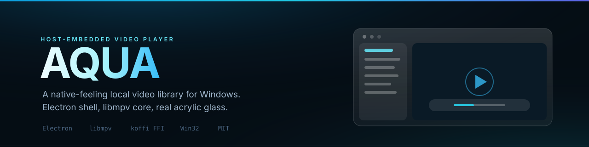

<div align="center">
  
</div>

<br>

<div align="center">

**一个苹果风格的本地视频播放器，带毛玻璃侧边栏。**

侧边栏是真的半透明 —— 它背后模糊的是正在播放的画面，不是一层假图片。内核用 mpv，画质和兼容性跟 mpv 一样。

[](#requirements)
[](#requirements)
[](LICENSE)

[Features](#features) · [Install](#install) · [Controls](#controls) · [Questions](#common-questions)

</div>

---

## What it is

Most video players on Windows either look like a 2010 media centre or are a bare window with mpv's own on-screen controls bolted on.

AQUA keeps mpv's playback engine — so it opens everything, seeks precisely and handles subtitles properly — and puts a proper interface on top: a title bar, a frosted sidebar that lists your folder, and a control capsule at the bottom.

Drag a folder onto the sidebar and it lists every video inside. Click one and it plays.

---

## Features

### Playing

| | |
|---|---|
| **Hold to speed up** | Hold the skip button: after a moment it goes 2×, then 5×, then 12×. Let go and it returns to normal speed |
| **Scrub precisely** | Drag the progress bar and it seeks frame-accurately, with the sound muted while you drag and restored when you let go |
| **Hover for a preview** | Rest the pointer on the progress bar to see a thumbnail of that moment |
| **Speed without the chipmunk voice** | 0.5× to 2×, and voices stay natural at 1.5× and 2× |
| **Picture in picture** | <kbd>Ctrl</kbd>+<kbd>P</kbd> shrinks the window to a small always-on-top box that keeps the video's shape |
| **Fullscreen that gets out of the way** | Press <kbd>F</kbd>; after 2.5 seconds of stillness the cursor hides, and moving the mouse brings it back |
| **Plays the next one** | When a video ends, the next file in the folder starts |

### The sidebar

| | |
|---|---|
| **Summon it at the edge** | Move the pointer to the right edge of the window for a moment and it slides out; move away and it slides back |
| **Opens by default** | It is open when you start the player. <kbd>Ctrl</kbd>+<kbd>B</kbd> or <kbd>Ctrl</kbd>+<kbd>\</kbd> toggles it |
| **Any folder** | Pick one with the button or <kbd>Ctrl</kbd>+<kbd>O</kbd>, drop one from Explorer, or use the recent list |
| **Breadcrumbs** | The path is clickable — jump back to any parent folder |
| **Sort and filter** | By name, date, length or how far you watched. Type in the box to filter |
| **Shows your progress** | Each item has a thin progress line underneath, and finished ones get a tick |
| **Finds subtitles** | A matching `.srt`, `.ass` or `.vtt` shows a **CC** badge and loads automatically; matching audio shows **♪** |
| **Remembers where you were** | Playback position is saved and resumed next time |
| **Handles missing files** | Deleted files grey out instead of breaking the player |
| **Right-click to manage** | Show in Explorer, copy the path, attach a subtitle, rename, hide, or send to the recycle bin |
| **Thousands of files** | The list only draws what is on screen, so a folder with 10,000 videos still scrolls smoothly |

---

## Requirements

- Windows 10 or 11 (64-bit)
- The mpv playback engine, which is **not** included in this repository — see below

## Install

### The easy way

Download `AQUA-1.0.0-Setup.exe` from [Releases](https://github.com/13734795725zhao-rgb/aqua-lan-player/releases) and run it. Everything, including the playback engine, is inside.

The installer is not code-signed, so Windows will warn you once: **More info → Run anyway**. Uninstall it from Settings → Apps like any other program.

### From source

You need to supply the mpv runtime yourself — a folder of files including `libmpv-2.dll`, about 167 MB in total.

1. Get a 64-bit mpv build (either compile it, or download any 64-bit mpv release)
2. Copy its `.dll` files and `libmpv-2.dll` into a folder called `bin` next to `app`
3. Then:

```bash
git clone https://github.com/13734795725zhao-rgb/aqua-lan-player.git
cd aqua-lan-player/app
npm install
npm start
```

If the player opens but the video area stays black, the `bin` folder is usually the problem — check that `libmpv-2.dll` is directly inside it.

### Build the installer yourself

```bash
cd app
npm run dist
```

---

## Controls

| What you want | How |
|---|---|
| Play / pause | <kbd>Space</kbd>, or click the picture |
| Back or forward 10 seconds | The buttons beside play. Hold one to speed up |
| Volume | <kbd>↑</kbd> <kbd>↓</kbd>, the mouse wheel, or rest the pointer on the speaker |
| Speed up / slow down | <kbd>[</kbd> and <kbd>]</kbd>; <kbd>\</kbd> resets to normal |
| Sidebar | <kbd>Ctrl</kbd>+<kbd>B</kbd> or <kbd>Ctrl</kbd>+<kbd>\</kbd> |
| Choose a folder | <kbd>Ctrl</kbd>+<kbd>O</kbd> |
| Picture in picture | <kbd>Ctrl</kbd>+<kbd>P</kbd> |
| Fullscreen | <kbd>F</kbd>, or double-click the picture |
| Previous / next file | <kbd>Ctrl</kbd>+<kbd>←</kbd> / <kbd>Ctrl</kbd>+<kbd>→</kbd> |
| Switch clock between elapsed and remaining | Click the time |
| Resize the sidebar | Drag its left edge |

---

## Common questions

| Problem | What to do |
|---|---|
| The video area is black but sound plays | Normal installs do not hit this. From source, it means the `bin` folder with the mpv files is missing or incomplete |
| Windows warns me when I run the installer | It is not code-signed. Choose **More info → Run anyway** |
| The sidebar disappeared | Press <kbd>Ctrl</kbd>+<kbd>B</kbd>, or move the pointer to the right edge of the window |
| A file shows greyed out with a line through it | The file was moved or deleted |
| Subtitles are not loading | They must sit next to the video with the same name, for example `movie.mp4` and `movie.srt` |
| Speed changing makes voices squeaky | It should not — pitch correction is on. If it does, report it with the video format you used |

---

## Good to know

- Windows only.
- The interface is in Chinese.
- Videos are played from where they are; the player never moves or copies your files.
- Saved positions and settings live in your user folder, not next to the videos.

---

## More

| Document | Contents |
|---|---|
| [`docs/README.zh-CN.md`](docs/README.zh-CN.md) | Full documentation in Chinese, including how to build mpv yourself |

## License

[MIT](LICENSE) © 2026 幻蝶

mpv and FFmpeg are separate projects under their own licences. They are not included in this repository; if you build an installer that bundles them, those licences apply to that build.

---

<div align="center">
<sub>Because a good engine deserves a better window.</sub>
</div>
